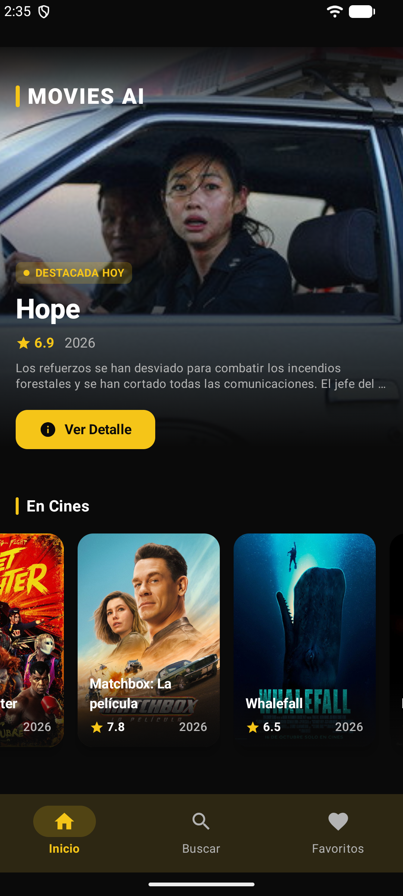
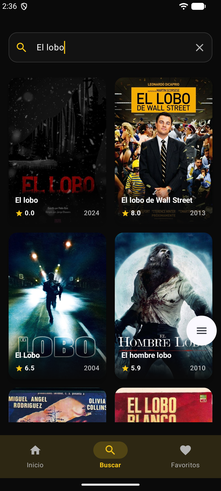
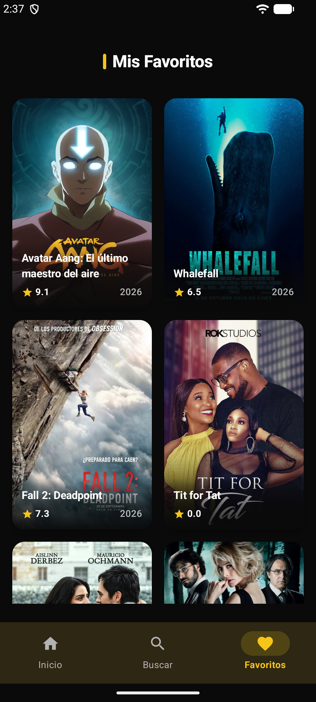

# 🎬 Películas Mobile App (TMDb)

Una aplicación móvil moderna para Android desarrollada con **Kotlin**, **Jetpack Compose** y **Clean Architecture**, consumiendo la API oficial de **The Movie Database (TMDb)**. Este proyecto ha sido construido utilizando la metodología **SDD (Specification-Driven Development)** asistida por agentes de IA.

---

## 📸 Capturas de Pantalla

<p align="center">
  
  &nbsp;&nbsp;&nbsp;&nbsp;
  
  &nbsp;&nbsp;&nbsp;&nbsp;
  
</p>

## 🚀 Características Principales

- **🧭 Home Dinámico & Múltiples Categorías:** Explora películas en cines, próximos estrenos, mejor valoradas y populares a través de carruseles horizontales fluidos y un banner de contenido destacado.
- **🔍 Búsqueda en Tiempo Real:** Filtra películas al instante utilizando corrutinas con *debounce*.
- **📱 Pantalla de Detalle Inmersiva ("Modo Cine"):** Visualización de fondo estilo *backdrop*, chips de géneros, sinopsis ampliada, **reparto principal (cast)** con imágenes de perfil y **recomendaciones de películas similares**.
- **❤️ Sistema de Favoritos Offline:** Guarda tus películas favoritas de forma local utilizando **Room Database** y consúltalas en cualquier momento desde la pestaña dedicada.
- **🎨 Diseño UI de Nivel Producción:** Interfaz oscura (*Dark Theme* por defecto), gradientes inmersivos sobre imágenes y efectos de carga fluidos (*Shimmer*).

---

## 🏛️ Arquitectura y Principios

El proyecto sigue estrictamente **Clean Architecture** dividida en tres capas desacopladas:

1. **Domain (`domain/`):** Modelos de negocio puros, interfaces de repositorios y casos de uso (*UseCases*). Sin dependencias de Android.
2. **Data (`data/`):** Implementación de la API con **Retrofit**, mapeadores de DTOs a Entidades y persistencia local con **Room Database**.
3. **Presentation (`presentation/`):** Interfaces de usuario construidas 100% con **Jetpack Compose** y **Material 3**, siguiendo el flujo de datos unidireccional (UDF) con `StateFlow` y ViewModels.

---

## 🛠️ Stack Tecnológico

- **Lenguaje:** Kotlin
- **UI:** Jetpack Compose, Material 3, Coil (carga de imágenes)
- **Arquitectura:** Clean Architecture + UDF
- **Inyección de Dependencias:** Hilt (Dagger)
- **Red:** Retrofit & OkHttp
- **Base de Datos Local:** Room
- **Asincronía:** Kotlin Coroutines & Flow
- **Metodología:** SDD (Specification-Driven Development)

---

## ⚙️ Configuración y Ejecución

1. Clona el repositorio:
   ```bash
   git clone [https://github.com/Robencho/movies_app.git](https://github.com/Robencho/movies_app.git)